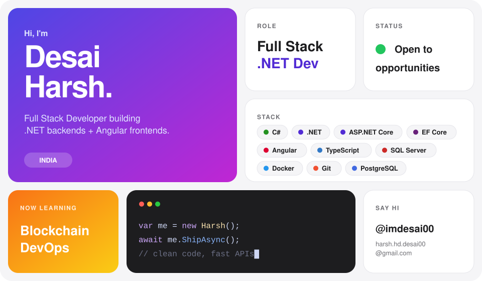

<!-- DESIGN 11 · MERGED (03 + 05 + 09)
     09 Bento tiles = who you are · 05 = headline, badges, TL;DR, activity · 03 = neofetch toolbox.
     One palette (indigo → fuchsia). Every image follows GitHub's light/dark theme. -->

<picture>
  <source media="(prefers-color-scheme: dark)" srcset="./bento-dark.svg">
  
</picture>

<br/>
<p align="center">
  <a href="mailto:harsh.hd.desai00@gmail.com"></a>
  <a href="https://x.com/imdesai00"></a>
  <!-- LINKEDIN: replace YOUR_LINKEDIN_ID, then uncomment
  <a href="https://www.linkedin.com/in/YOUR_LINKEDIN_ID"></a>
  -->
</p>

## ⚡ TL;DR
> Full Stack Developer shipping **ASP.NET Core APIs**, **SQL Server** data layers and **Angular** frontends.
> Currently levelling up in **DevOps** (Docker, CI/CD) and **Blockchain**.

## 🧰 Toolbox
<picture>
  <source media="(prefers-color-scheme: dark)" srcset="./neofetch-dark.svg">
  
</picture>

<!-- FEATURED PROJECTS: fill in real repos + a real number each, then uncomment. Do NOT publish placeholders.
## 🏗️ Featured projects
<table>
<tr>
<td width="50%" valign="top">

#### 🔹 [repo-name](https://github.com/imdesai00/repo-name)
**Problem →** what pain it removes<br/>
**Result →** a real number (e.g. *cut report time 8s → 600ms*)<br/>
  

</td>
<td width="50%" valign="top">

#### 🔹 [repo-name](https://github.com/imdesai00/repo-name)
**Problem →** what pain it removes<br/>
**Result →** a real number or live demo link<br/>
 

</td>
</tr>
</table>
-->

<!-- EXPERIENCE: fill in, then uncomment.
## 🧭 Experience
```diff
+ 20XX – now   Full Stack Developer (.NET) @ Company     → what you own, one metric
+ 20XX – 20XX  Previous role @ Company                   → what you shipped
```
-->

## 📈 Activity
<p align="center">
  <picture>
    <source media="(prefers-color-scheme: dark)" srcset="https://streak-stats.demolab.com?user=imdesai00&date_format=M%20j%5B%2C%20Y%5D&disable_animations=true&background=161B22&border=30363D&ring=C026D3&fire=C026D3&currStreakLabel=C084FC&sideLabels=F0F6FC&currStreakNum=F0F6FC&sideNums=F0F6FC&dates=8B949E&stroke=30363D">
    
  </picture>
  <picture>
    <source media="(prefers-color-scheme: dark)" srcset="https://github-profile-summary-cards.vercel.app/api/cards/stats?username=imdesai00&theme=github_dark">
    
  </picture>
</p>


